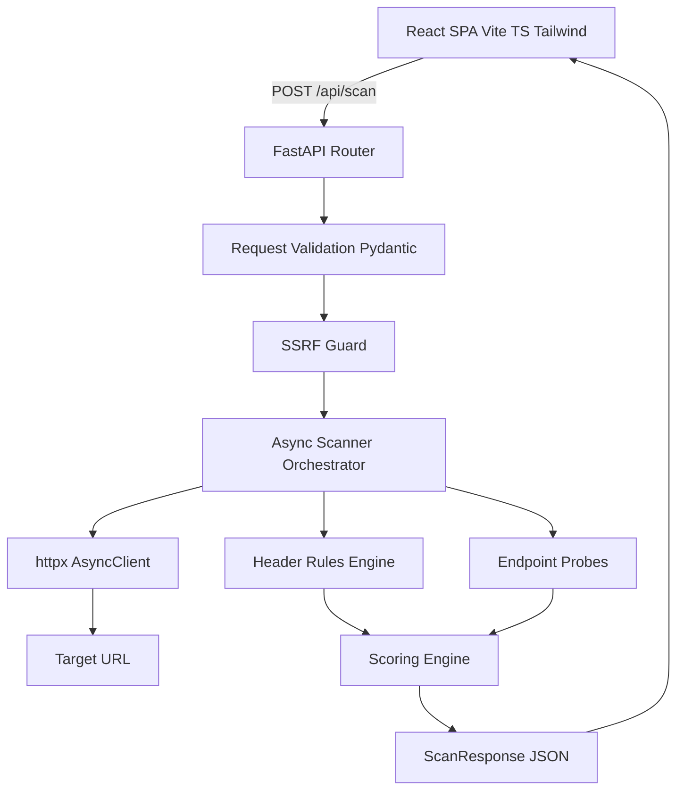
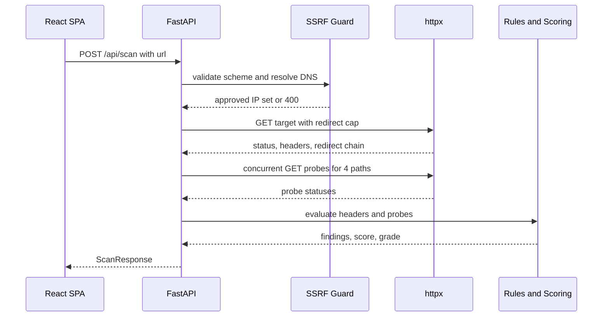

# CipherStack

CipherStack is a lightweight security scanner that analyzes HTTP response headers, evaluates exposed sensitive endpoints, and provides instant security scoring with actionable remediation tips.

Enter a URL, get a letter grade from **A+** to **F**, a weighted score out of 100, a per-header verdict, and a list of sensitive paths that responded.

## Features

- **Six security headers evaluated** — CSP, HSTS, X-Frame-Options, X-Content-Type-Options, Referrer-Policy, Permissions-Policy.
- **Three-state verdicts** — `Pass`, `Warning` (present but weak), `Missing`, each with a one-sentence remediation tip.
- **Sensitive endpoint probes** — `/.git/HEAD`, `/robots.txt`, `/.env`, `/sitemap.xml`.
- **Weighted scoring** — passing earns full weight, warnings earn half, missing earns zero.
- **Grade caps** — an exposed `/.git/HEAD` caps the grade at F; an exposed `/.env` caps it at D.
- **SSRF hardened** — scheme allowlist, DNS resolution before connect, private/loopback/link-local/reserved address blocking, redirect cap, timeout, and response size cap.
- **Stateless** — nothing is persisted.

## Architecture





## Project layout

```
CipherStack/
├── backend/
│   ├── app/
│   │   ├── main.py        # FastAPI app, routes, CORS, error handlers
│   │   ├── models.py      # Pydantic contracts
│   │   ├── security.py    # SSRF guard
│   │   ├── rules.py       # Header evaluation rules
│   │   ├── probes.py      # Sensitive endpoint probes
│   │   ├── scoring.py     # Weighted score to letter grade
│   │   └── scanner.py     # Async orchestration
│   ├── tests/
│   ├── requirements.txt
│   └── pyproject.toml
├── frontend/
│   └── src/
│       ├── components/
│       ├── hooks/useScan.ts
│       ├── lib/api.ts
│       ├── types.ts
│       └── App.tsx
└── plans/implementation-plan.md
```

## Setup

### Backend

Requires **Python 3.11, 3.12, or 3.13**. Python 3.14 is not supported yet: `pydantic-core` has no prebuilt wheel for it, so `pip install` falls back to compiling Rust and fails without MSVC build tools.

```bash
cd backend
python -m venv .venv
.venv\Scripts\activate
pip install -r requirements.txt
uvicorn app.main:app --reload --port 8000
```

On macOS or Linux, activate with `source .venv/bin/activate`.

If your default `python` is 3.14, create the venv with an explicit interpreter:

```bash
py -3.12 -m venv .venv
```

Or let `uv` fetch a managed interpreter, which is the most reliable option on Windows:

```bash
uv venv --python 3.12 .venv
uv pip install --python .venv\Scripts\python.exe -r requirements.txt
```

Verify the venv is on a supported version before installing:

```bash
.venv\Scripts\python.exe --version
```

The API is served at `http://127.0.0.1:8000`. Interactive docs are at `http://127.0.0.1:8000/docs`.

To run the test suite and linter:

```bash
pip install -r requirements-dev.txt
pytest
ruff check app tests
```

### Frontend

Requires Node.js 18 or newer.

```bash
cd frontend
npm install
npm run dev
```

The app is served at `http://localhost:5173`. In development, Vite proxies `/api` to `http://127.0.0.1:8000`, so no CORS configuration is needed locally.

For a production build, set the API origin and build:

```bash
# frontend/.env
VITE_API_BASE_URL=https://api.your-domain.com

npm run build
```

## API

### `POST /api/scan`

Request:

```json
{ "url": "example.com" }
```

A missing scheme defaults to `https://`.

Response `200`:

```json
{
  "target": "https://example.com",
  "final_url": "https://example.com",
  "status_code": 200,
  "grade": "C",
  "score": 62.5,
  "findings": [
    {
      "header": "Content-Security-Policy",
      "verdict": "missing",
      "value": null,
      "tip": "Define a Content-Security-Policy that restricts script sources to trusted origins.",
      "weight": 25
    }
  ],
  "endpoints": [
    {
      "path": "/.git/HEAD",
      "status_code": 404,
      "exposed": false,
      "severity": "none",
      "note": "Git metadata is not publicly accessible."
    }
  ],
  "redirects": [],
  "flags": [],
  "scanned_at": "2026-01-01T00:00:00Z"
}
```

Errors use a consistent shape:

```json
{ "detail": { "code": "blocked_target", "message": "Host '127.0.0.1' is not a public target" } }
```

| Status | Code | Meaning |
| --- | --- | --- |
| 400 | `blocked_target` | Scheme not allowed, or host resolves to a non-public address |
| 400 | `too_many_redirects` | Target exceeded the 3-hop redirect limit |
| 422 | `validation_error` | Request body failed validation |
| 502 | `resolution_failed` | DNS lookup failed |
| 502 | `connection_failed` | TCP connection could not be established |
| 504 | `timeout` | Target did not respond within 10 seconds |

### `GET /api/health`

Returns `{"status": "ok"}`.

## Scoring rubric

Each header carries a weight. A `Pass` earns the full weight, a `Warning` earns half, and `Missing` earns zero.

| Header | Weight | Passes when |
| --- | --- | --- |
| Content-Security-Policy | 25 | Present, and no `unsafe-inline`/`unsafe-eval` without a nonce or hash |
| Strict-Transport-Security | 20 | `max-age >= 15552000` and `includeSubDomains` |
| X-Frame-Options | 15 | `DENY` or `SAMEORIGIN` |
| X-Content-Type-Options | 15 | `nosniff` |
| Referrer-Policy | 15 | `no-referrer`, `strict-origin-when-cross-origin`, `same-origin`, or `strict-origin` |
| Permissions-Policy | 10 | Present with at least one directive |

Grade bands:

| Score | Grade |
| --- | --- |
| 95–100 | A+ |
| 85–94.9 | A |
| 75–84.9 | B |
| 60–74.9 | C |
| 45–59.9 | D |
| 0–44.9 | F |

Grade caps override the band when a sensitive endpoint is exposed:

- `/.git/HEAD` returning `200` caps the grade at **F**.
- `/.env` returning `200` caps the grade at **D**.
- `/robots.txt` and `/sitemap.xml` are informational and never affect the grade.

## Configuration

| Variable | Service | Default | Purpose |
| --- | --- | --- | --- |
| `CIPHERSTACK_CORS_ORIGINS` | backend | `http://localhost:5173,http://127.0.0.1:5173` | Comma-separated allowed origins |
| `VITE_API_BASE_URL` | frontend | empty (uses Vite proxy) | API origin for production builds |

## Security notes

CipherStack fetches arbitrary user-supplied URLs, so the SSRF guard is the primary control:

- Only `http` and `https` are accepted.
- Hostnames are resolved before connecting, and every resolved address is checked against private, loopback, link-local, reserved, multicast, and unspecified ranges.
- Redirects are followed manually, capped at three hops, and each hop is re-validated.
- Requests time out after 10 seconds and response bodies are capped at 256 KB.

The scanner is read-only and performs `GET` requests only. It does not authenticate, submit forms, or follow links found in responses.
