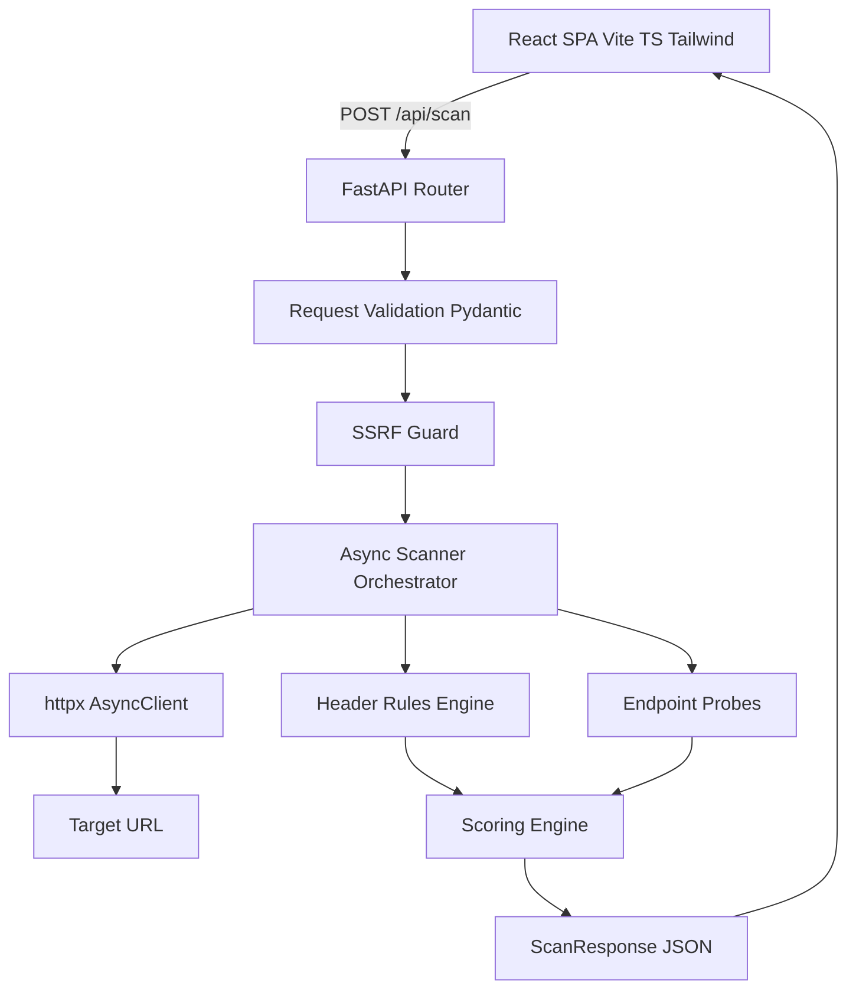
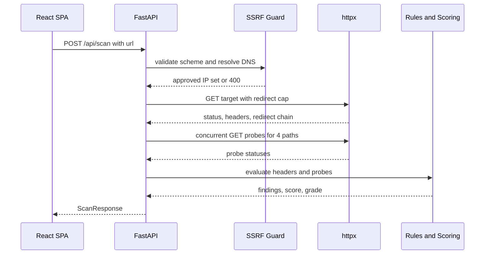

# CipherStack — Implementation Plan

A lightweight HTTP security header auditor. FastAPI backend, React + Vite + TypeScript + Tailwind frontend, served separately with CORS enabled.

## Scope Decisions

| Decision | Choice |
| --- | --- |
| Project name | CipherStack (keep existing README branding) |
| Frontend stack | React + Vite + TypeScript + Tailwind CSS |
| Deployment shape | Two services, separate dev servers, CORS enabled |
| SSRF protection | Enabled |
| Endpoint probes | `/.git/HEAD`, `/robots.txt`, `/.env`, `/sitemap.xml` |
| Persistence | None — stateless scans |

## Architecture



## Scan Flow



## Repository Layout

```
CipherStack/
├── backend/
│   ├── app/
│   │   ├── __init__.py
│   │   ├── main.py          # FastAPI app, routes, CORS, error handlers
│   │   ├── models.py        # Pydantic request/response contracts
│   │   ├── security.py      # SSRF guard
│   │   ├── rules.py         # Header evaluation rules
│   │   ├── probes.py        # Sensitive endpoint probes
│   │   ├── scoring.py       # Weighted score to letter grade
│   │   └── scanner.py       # Async orchestration
│   ├── tests/
│   │   ├── test_rules.py
│   │   ├── test_scoring.py
│   │   ├── test_security.py
│   │   └── test_api.py
│   ├── requirements.txt
│   └── pyproject.toml
├── frontend/
│   ├── src/
│   │   ├── components/
│   │   │   ├── UrlScanForm.tsx
│   │   │   ├── GradeBadge.tsx
│   │   │   ├── ScoreSummary.tsx
│   │   │   ├── HeaderAccordion.tsx
│   │   │   ├── EndpointList.tsx
│   │   │   └── ErrorBanner.tsx
│   │   ├── hooks/useScan.ts
│   │   ├── lib/api.ts
│   │   ├── types.ts
│   │   ├── App.tsx
│   │   ├── main.tsx
│   │   └── index.css
│   ├── index.html
│   ├── package.json
│   ├── tailwind.config.ts
│   ├── postcss.config.js
│   ├── tsconfig.json
│   └── vite.config.ts
├── plans/implementation-plan.md
├── .env.example
├── .gitignore
└── README.md
```

## Backend Design

### `models.py`

- `Grade` — `StrEnum` of `A+`, `A`, `B`, `C`, `D`, `F`.
- `Verdict` — `StrEnum` of `pass`, `warning`, `missing`.
- `ScanRequest` — `url: HttpUrl` with a validator that rejects non-http(s) schemes.
- `HeaderFinding` — `header`, `verdict`, `value: str | None`, `tip`, `weight`.
- `EndpointFinding` — `path`, `status_code: int | None`, `exposed: bool`, `severity`, `note`.
- `ScanResponse` — `target`, `final_url`, `status_code`, `grade`, `score`, `findings`, `endpoints`, `redirects`, `scanned_at`.

### `security.py`

- `validate_target(url) -> ValidatedTarget` — scheme allowlist, hostname presence, DNS resolution via `asyncio.get_running_loop().getaddrinfo`.
- Reject any resolved address in private, loopback, link-local, reserved, multicast, or unspecified ranges using `ipaddress.ip_address(...).is_private` plus explicit checks.
- Reject literal IP hosts that fail the same checks.
- `MAX_REDIRECTS = 3`, `REQUEST_TIMEOUT = 10.0`, `MAX_BODY_BYTES = 262_144`.
- Custom exceptions: `BlockedTargetError`, `ResolutionError`.

### `rules.py`

Pure functions, no I/O. Each rule returns a `HeaderFinding`.

| Header | Weight | Pass | Warning | Missing |
| --- | --- | --- | --- | --- |
| Content-Security-Policy | 25 | present, no `unsafe-inline`/`unsafe-eval` without nonce or hash | present but permissive | absent |
| Strict-Transport-Security | 20 | `max-age >= 15552000` and `includeSubDomains` | `max-age` below threshold or missing `includeSubDomains` | absent |
| X-Frame-Options | 15 | `DENY` or `SAMEORIGIN` | `ALLOW-FROM` or unrecognized value | absent |
| X-Content-Type-Options | 15 | `nosniff` | any other value | absent |
| Referrer-Policy | 15 | `no-referrer`, `strict-origin-when-cross-origin`, `same-origin` | `unsafe-url`, `origin`, `origin-when-cross-origin` | absent |
| Permissions-Policy | 10 | present with at least one directive | present but empty | absent |

Each finding carries a one-sentence remediation tip. Header lookup is case-insensitive.

### `probes.py`

- `PROBE_PATHS = ("/.git/HEAD", "/robots.txt", "/.env", "/sitemap.xml")`.
- Probes run concurrently with `asyncio.gather(..., return_exceptions=True)`.
- Classification:
  - `/.git/HEAD` → 200 is `critical` (source disclosure).
  - `/.env` → 200 is `high` (secret disclosure).
  - `/robots.txt`, `/sitemap.xml` → 200 is `info`, never penalized.
  - 403/404/410 → not exposed.
  - Network error → `status_code: None`, not exposed, note recorded.

### `scoring.py`

- `score = sum(earned_weight) / sum(total_weight) * 100`, where `pass` earns full weight, `warning` earns half, `missing` earns zero.
- Grade bands: `>= 95` A+, `>= 85` A, `>= 75` B, `>= 60` C, `>= 45` D, else F.
- Grade caps: `/.git/HEAD` exposed → cap at F; `/.env` exposed → cap at D.
- Returns `(score, grade, flags)` where flags explain any cap that was applied.

### `scanner.py`

- `scan(url) -> ScanResponse`.
- Builds one `httpx.AsyncClient` with `follow_redirects=False`, `timeout=REQUEST_TIMEOUT`, and a browser-like `User-Agent`.
- Manual redirect loop: validate each hop through the SSRF guard, record the chain, stop at `MAX_REDIRECTS`.
- Streams the body with a byte cap, then discards it — only headers and status are retained.
- Runs endpoint probes against the final URL origin.
- Delegates to `rules.evaluate_headers` and `scoring.compute_grade`.

### `main.py`

- `POST /api/scan` → `ScanResponse`.
- `GET /api/health` → `{"status": "ok"}`.
- CORS origins from `CIPHERSTACK_CORS_ORIGINS` env var, defaulting to `http://localhost:5173`.
- Exception handlers mapping `BlockedTargetError` → 400, `ResolutionError` → 502, `httpx.TimeoutException` → 504, `httpx.ConnectError`/`httpx.HTTPError` → 502, all with `{"detail": {"code", "message"}}`.
- `httpx.AsyncClient` created in a lifespan context and shared across requests.

## Frontend Design

### Theme

Dark-first. Background `#0a0b0f`, surface `#12141a`, border `#1f2330`, text `#e6e8ee`, muted `#8b90a0`, accent `#4f8cff`. Grade colors: A+/A emerald, B lime, C amber, D orange, F rose.

### Components

- `UrlScanForm` — controlled input, URL normalization (prepend `https://` when no scheme), submit on Enter, disabled + spinner while loading.
- `GradeBadge` — large letter grade with color derived from grade.
- `ScoreSummary` — numeric score, target host, final URL, HTTP status, redirect count, counts of pass/warning/missing.
- `HeaderAccordion` — native `<details>` per finding, verdict pill, current value in monospace, remediation tip shown when not passing.
- `EndpointList` — table of probed paths with status code and exposure severity.
- `ErrorBanner` — renders `detail.code` and `detail.message` from the API.

### State

`useScan` hook exposes `{ status, result, error, scan }` with `status: 'idle' | 'loading' | 'success' | 'error'`. Aborts in-flight requests via `AbortController` when a new scan starts.

### Config

- `vite.config.ts` proxies `/api` to `http://127.0.0.1:8000` in dev.
- `VITE_API_BASE_URL` overrides the base URL for production builds.

## Testing

- `test_rules.py` — each header across pass/warning/missing, case-insensitive lookup.
- `test_scoring.py` — grade band boundaries, warning half-credit, grade caps.
- `test_security.py` — rejects `file://`, `localhost`, `127.0.0.1`, `10.0.0.1`, `169.254.169.254`, `::1`, `0.0.0.0`.
- `test_api.py` — `httpx.MockTransport` for a healthy target, a target missing all headers, and a blocked target.

## Setup

Backend:

```
cd backend
python -m venv .venv
.venv\Scripts\activate
pip install -r requirements.txt
uvicorn app.main:app --reload --port 8000
```

Frontend:

```
cd frontend
npm install
npm run dev
```

## Execution Order

1. Scaffold directories, `.gitignore`, `.env.example`.
2. Backend models → security → rules → probes → scoring → scanner → main.
3. Backend dependencies and tooling config.
4. Backend tests.
5. Frontend scaffold and theme.
6. Frontend types, API client, hook.
7. Frontend components and app shell.
8. README rewrite.
